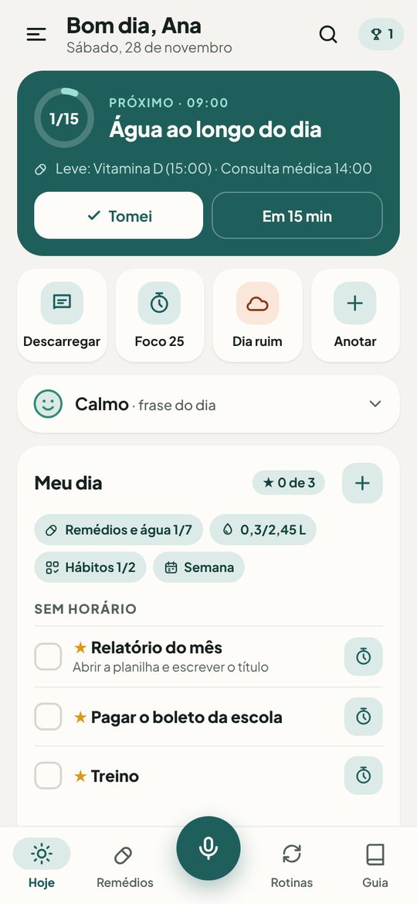
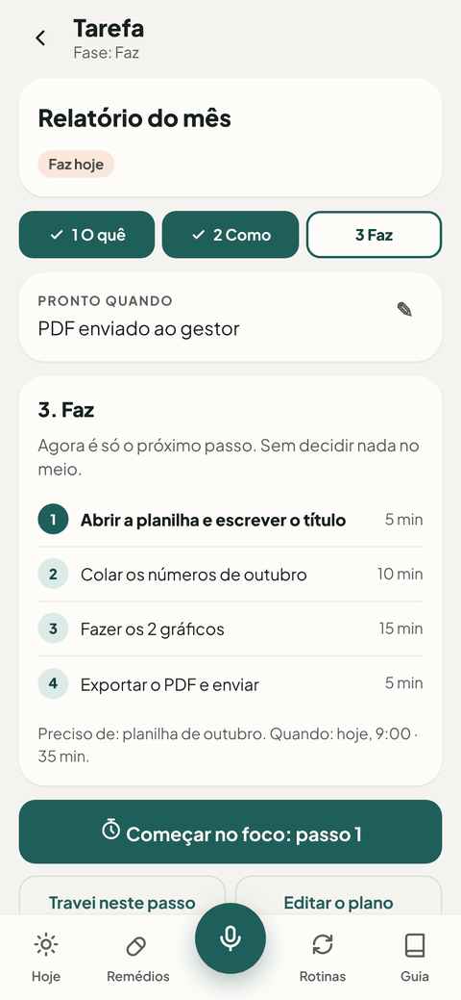

# TDAH na Vida Real

App Android para tirar a rotina da cabeça. Ele lembra dos remédios e da água, ajuda a decidir o que fazer primeiro, separa o "o que fazer" do "fazer" e tem um assistente de IA opcional que fatia tarefas grandes em passos de minutos.

Sem conta e sem servidor: os dados ficam no celular, e o backup vai para o Google Drive de quem usa.

<p>




</p>

> O app ajuda a organizar a rotina, mas não substitui avaliação nem acompanhamento médico ou psicológico. Em crise, ligue 188 (CVV) ou 192 (SAMU).

## O que ele faz

| Área | O que tem |
| --- | --- |
| **Hoje** | Resumo do dia com o próximo passo, ações rápidas (descarregar, foco de 25 min, dia ruim, anotar), as 3 do dia, agenda do celular, descarrego mental por voz e um modo "dia ruim" com só 5 caixinhas. |
| **Captura mágica** | Escreva ou fale do seu jeito: "dentista sexta 15h no centro", "pagar a luz todo dia 10". O app separa a data, a hora, o local, a repetição e a categoria, e avisa no horário. Funciona sem IA; com IA, ainda fatia em passos. |
| **Humor em 1 toque** | Check-in na tela Hoje (animado, calmo, cansado, ansioso, pra baixo), com a frase do dia de recompensa, a energia e o humor da semana. |
| **Remédios e água** | Aviso na hora com **Tomei** e **Lembrar em 15 min**, novo aviso se você não marcar e aviso para **levar o remédio** quando a agenda tem compromisso no horário. |
| **Próximo fixo** | Uma notificação fixa, sem som, com o próximo remédio e o passo atual, que só sai quando você conclui. |
| **Prioridades** | Matriz de Eisenhower: Faz hoje, Agenda, Rápido ou repassa e Solta. Prazo até amanhã sobe para urgente; o que fica 7 dias na Solta vai para "Talvez um dia". Sugere as 3 do dia: uma do Faz hoje, uma da Agenda e uma rápida. |
| **Tarefa em 3 fases** | **O quê** (pronto quando), **Como** (passos com minutos, material, quando) e **Faz** (os passos ficam travados e o foco mostra só o atual). |
| **Repetição e categorias** | Todo dia, dias úteis, dias da semana ou todo mês. Ao concluir (ou pular), a próxima volta sozinha. Categorias com cor (Casa, Trabalho, Saúde…) viram filtro na matriz. |
| **Bloco de foco** | Timer escuro com sino no fim, mesmo com a tela apagada; opção de tocar no silencioso e aviso 2 minutos antes. Dá para estacionar uma ideia sem sair do foco. |
| **Rotinas** | 7 rotinas prontas (manhã, trabalho, foco, fim do expediente, noite, semana e SOS), com lembrete, versão mínima e dica para quando travar. |
| **Guia** | 100 estratégias em 10 temas. Monte o seu kit, marque o status e anote o que funcionou. |
| **Assistente de IA** | Opcional. Fala ou texto, com Gemini (Google) ou Claude (Anthropic), no tom que você escolher: direto, encorajador ou bem-humorado. Vê a agenda, o dia e o humor, cria e fatia tarefas, marca passos, organiza o descarrego, cria lembretes e horários, marca compromissos da casa, fecha o dia e faz o resumo da semana. |
| **Agenda da casa** | Um calendário do Google compartilhado: o que uma pessoa marca aparece no celular da outra. |
| **Compartilhar tarefa** | Manda uma tarefa pelo WhatsApp como link. Quem tem o app toca e a tarefa abre direto nele, com passos e prazo, pronta para entrar na matriz. |
| **Resumo da semana** | Domingo às 19h: tarefas concluídas, as 3 do dia, remédios marcados, humor e o dia que mais rendeu. |
| **Mais** | Revisão da semana, ideias, hábitos sem data, lembretes, tema claro, escuro ou automático e configuração guiada na primeira abertura. |

## Instalar no celular

1. Abra a página de [Releases](../../releases/latest) no celular e baixe `tdah-vida-real.apk`.
2. Toque no arquivo. Se o Android pedir, permita "instalar apps desconhecidos" para o navegador ou o app de arquivos.
3. Se o Play Protect avisar que o app é desconhecido, toque em **Mais detalhes › Instalar mesmo assim**. O aviso aparece porque o app não está na Play Store.
4. Abra o app e responda a configuração guiada (uns 5 minutos).

Versões novas instalam **por cima** da anterior, sem perder dados. Não desinstale antes de atualizar: desinstalar apaga o que não estiver no backup.

Requer Android 7 ou mais novo. Não há versão para iPhone.

## Primeiro uso

1. **Configuração guiada:** horários, o que mais trava, remédios e água, um texto sobre você para o assistente e as permissões.
2. **Permissões:** Notificações e "Alarmes e lembretes" para os avisos chegarem na hora; Agenda para ler os compromissos; Microfone só para o ditado.
3. **Teste o sino:** menu ☰ › Ajustes › Bloco de foco › **Testar**.
4. **Backup:** menu ☰ › Ajustes › **Conectar Google Drive**. O app grava sozinho a cada 6 horas de uso.
5. **IA (opcional):** toque no microfone do meio da barra de baixo e cole a sua chave.

Para a agenda do trabalho aparecer, ela precisa estar sincronizada no calendário do Android (no app do Outlook: Configurações › sua conta › Sincronizar calendários).

## Assistente de IA

Cada pessoa usa a própria chave de API, que fica só no celular e nunca vai no backup.

| | Gemini (Google) | Claude (Anthropic) |
| --- | --- | --- |
| Custo | Plano gratuito com limite de uso; só cobra se você ativar o faturamento | Pago por uso, com créditos na conta |
| Assinatura cobre a API? | Não | Não |
| Onde pegar a chave | [aistudio.google.com/app/apikey](https://aistudio.google.com/app/apikey) | [console.anthropic.com/settings/keys](https://console.anthropic.com/settings/keys) |
| Privacidade | No plano gratuito, o Google pode usar o conteúdo enviado para melhorar os produtos, inclusive com revisão humana ([termos](https://ai.google.dev/gemini-api/terms)) | Vale a política de dados da Anthropic para a API |

Por padrão, o assistente não recebe os nomes dos remédios nem os itens do "Corpo em dia"; isso só muda se você ligar a opção em Ajustes. A chamada vai direto do celular para a API escolhida, sem servidor no meio.

## Privacidade e dados

- **Tudo fica no aparelho**, num banco IndexedDB dentro do app. Não existe cadastro.
- **Backup no seu Google Drive:** o app grava num arquivo que você escolhe, pelo seletor de arquivos do Android. Nenhum servidor nosso, nenhum login extra.
- **O que sai do celular:** o backup no seu Drive, o que você manda ao assistente de IA e os compromissos da Agenda da casa, que ficam no seu Google Agenda.
- **Tarefa compartilhada:** o conteúdo vai dentro do link, depois do `#`, parte que o navegador não envia a nenhum servidor. O site `cidedson.github.io` só faz a ponte para abrir o app.
- **O que nunca sai:** a chave de API.
- Também dá para exportar e importar um backup em JSON por Ajustes.

## Como funciona por dentro

- **Interface:** JavaScript puro em `src/`, empacotado com esbuild em `www/app.js`. Estilos e tema em `www/index.html`.
- **App Android:** [Capacitor](https://capacitorjs.com) 8, com os plugins de notificações locais, agenda, reconhecimento de voz, arquivos e compartilhamento.
- **Código nativo próprio** em `android/app/src/main/java/com/cidedson/tdahvidareal/`:
  - `DocBackupPlugin.java`: backup e restauração num arquivo do Google Drive pelo seletor de documentos do Android.
  - `AlertaPlugin.java`: canais de notificação do foco (sino normal, no silencioso e só vibrar) e da notificação fixa.
- **Arquivos principais:**

| Arquivo | O que tem |
| --- | --- |
| `src/app.js` | Telas, navegação, foco, prioridades, notificação fixa |
| `src/assistant.js` | Assistente (Claude e Gemini), ferramentas e o fatiador de tarefas |
| `src/native.js` | Agenda, notificações, voz, backup no Drive |
| `src/db.js` | Banco IndexedDB, exportar e importar |
| `src/content.js` | As 100 estratégias e as 7 rotinas |

## Gerar o APK

O APK é gerado pelo GitHub Actions (`.github/workflows/android.yml`) a cada push na branch `main` e publicado em Releases. Não precisa de Android Studio.

- A versão vem de `APP_VERSION` no workflow mais o número do build (ex.: `1.7.21`).
- Para a atualização instalar por cima, todo APK precisa ser assinado com a **mesma chave**. A chave não fica no repositório: o workflow lê dos secrets (Settings › Secrets and variables › Actions) e para com erro se eles faltarem.

| Secret | Conteúdo |
| --- | --- |
| `KEYSTORE_BASE64` | O arquivo `.keystore` em base64 (`base64 -w0 minha.keystore`) |
| `KEYSTORE_PASSWORD` | Senha do keystore |
| `KEY_ALIAS` | Alias da chave (se faltar, usa `tdah`) |
| `KEY_PASSWORD` | Senha da chave (se for igual à do keystore, pode omitir) |

Num fork, crie a sua própria chave com `keytool -genkeypair -v -keystore minha.keystore -alias minha -keyalg RSA -keysize 2048 -validity 10000`, cadastre os secrets e guarde o arquivo num lugar seguro: sem ele, não dá para atualizar o app por cima.

## Desenvolvimento

```bash
npm install
npm run build                                   # gera www/app.js
python3 -m http.server --directory www 8000     # testar no navegador (sem os recursos nativos)
npx cap sync android                            # copia para o projeto Android
```

No navegador, agenda, notificações e backup no Drive ficam desligados; o resto funciona, inclusive o assistente com uma chave.

## Versões

O que mudou em cada versão está em [CHANGELOG.md](CHANGELOG.md).

## Créditos

- Fonte [Plus Jakarta Sans](https://github.com/tokotype/PlusJakartaSans), licença SIL Open Font License 1.1 (`www/fonts/OFL.txt`).
- Feito com [Capacitor](https://capacitorjs.com) e [esbuild](https://esbuild.github.io).
