<p align="center">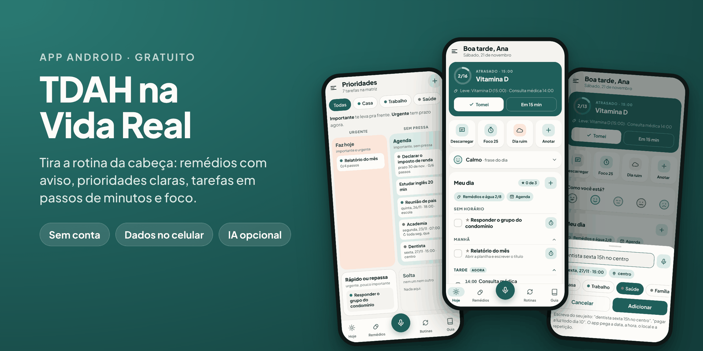</p>

<p align="center">
  <a href="../../releases/latest"></a>
  
  
  
</p>

# TDAH na Vida Real

App Android para tirar a rotina da cabeça. Ele lembra dos remédios e da água (até no silencioso), ajuda a decidir o que fazer primeiro, transforma tarefa grande em passos de minutos, guia a rotina passo a passo e segura o foco por 25 minutos. O assistente de IA é opcional.

Sem conta e sem servidor: os dados ficam no celular, e o backup vai para o Google Drive de quem usa.

**[Baixar a última versão](../../releases/latest)** · **[Tutorial guiado](https://cidedson.github.io/como-usar/)** · [Novidades](CHANGELOG.md) · [Instalar](#instalar-no-celular) · [Privacidade](#privacidade-e-dados) · [Como funciona](#como-funciona-por-dentro)

> O app ajuda a organizar a rotina, mas não substitui avaliação nem acompanhamento médico ou psicológico. Em crise, ligue 188 (CVV) ou 192 (SAMU).

## Telas

<table>
  <tr>
    <td align="center" width="33%"><br><sub><b>Hoje</b>: o dia num olhar</sub></td>
    <td align="center" width="33%">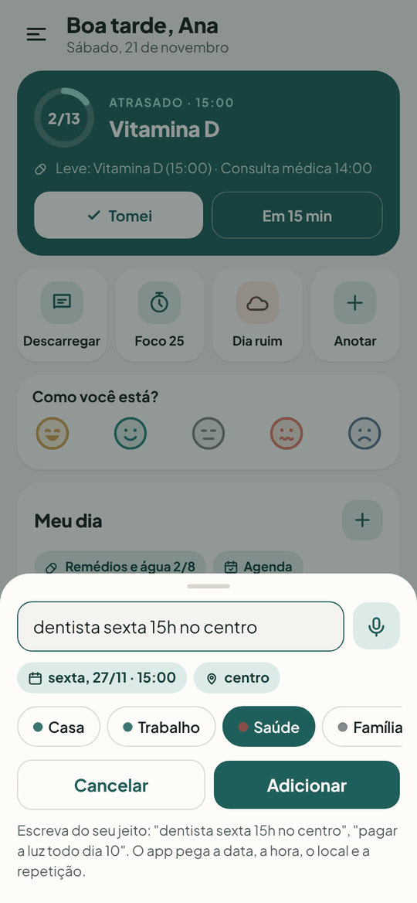<br><sub><b>Captura mágica</b>: escreve do seu jeito</sub></td>
    <td align="center" width="33%">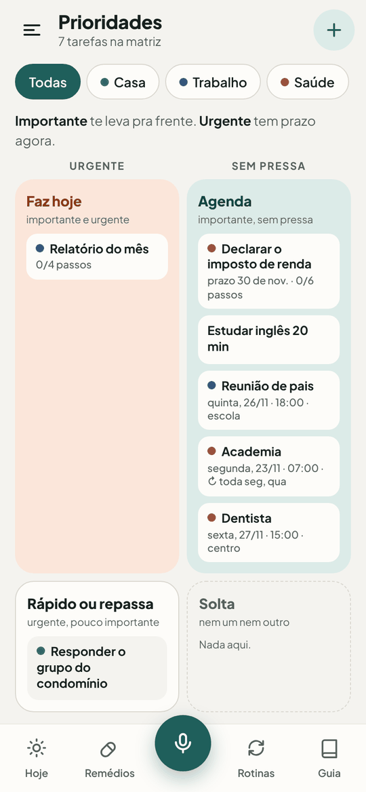<br><sub><b>Prioridades</b>: matriz com categorias</sub></td>
  </tr>
  <tr>
    <td align="center">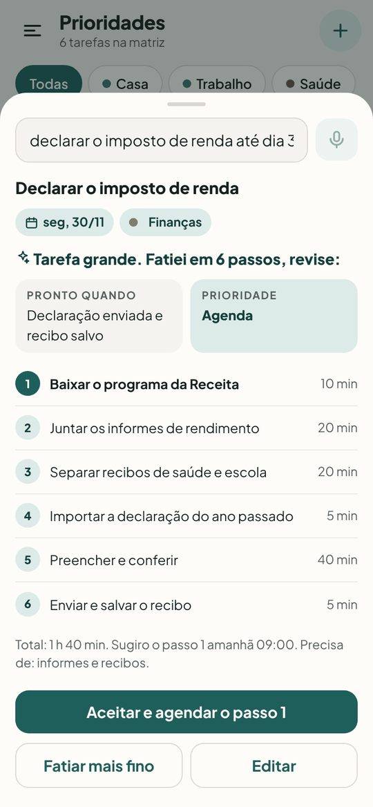<br><sub><b>IA fatia</b> a tarefa grande</sub></td>
    <td align="center">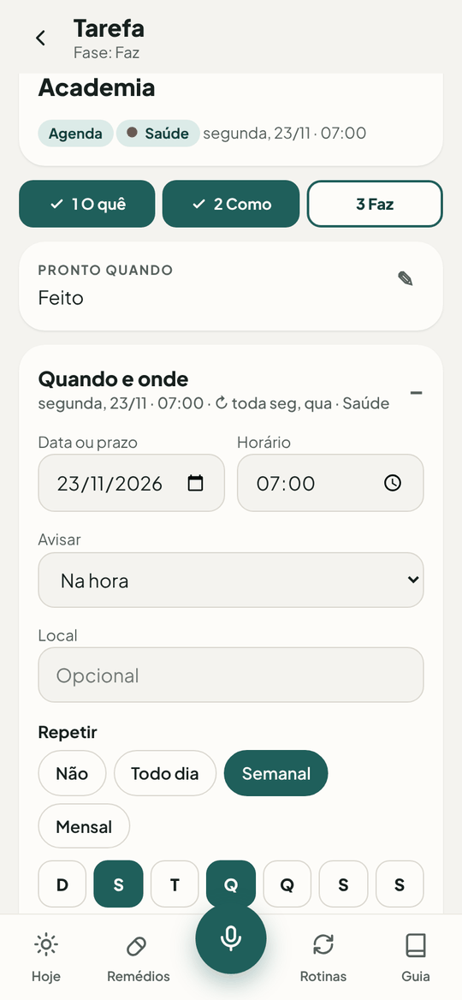<br><sub><b>Quando e onde</b>, com repetição</sub></td>
    <td align="center">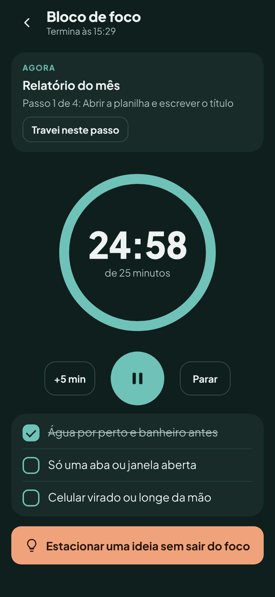<br><sub><b>Foco</b> de 25 min no passo atual</sub></td>
  </tr>
  <tr>
    <td align="center">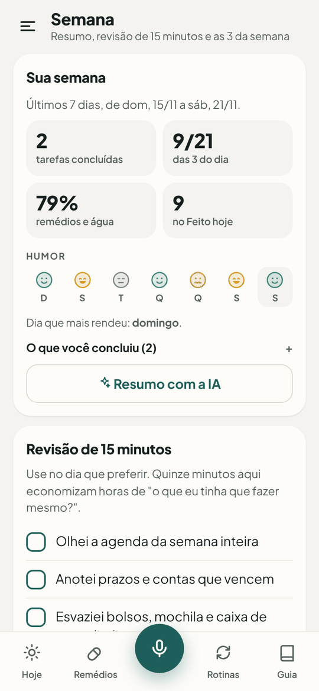<br><sub><b>Resumo da semana</b></sub></td>
    <td align="center">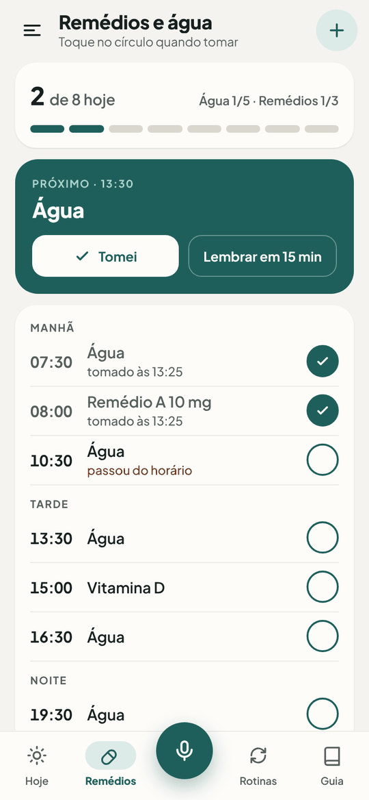<br><sub><b>Remédios e água</b> com aviso</sub></td>
    <td align="center">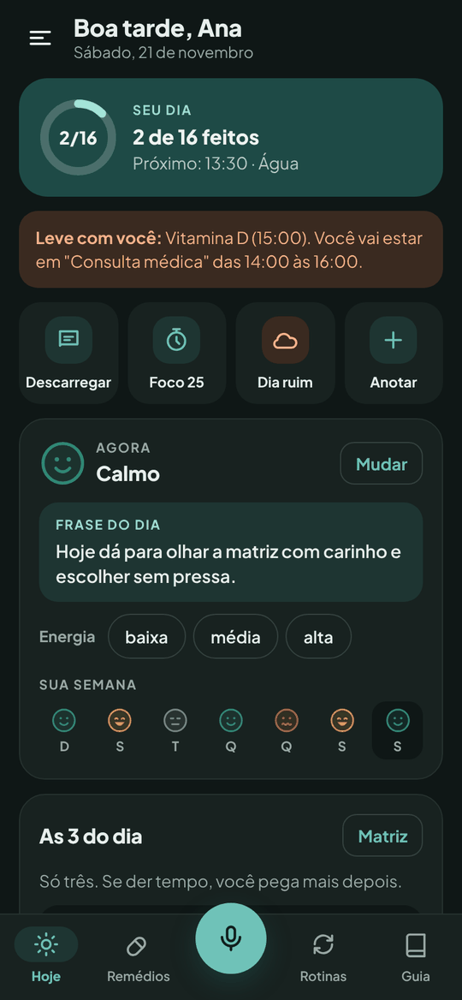<br><sub><b>Tema escuro</b> ou automático</sub></td>
  </tr>
  <tr>
    <td align="center">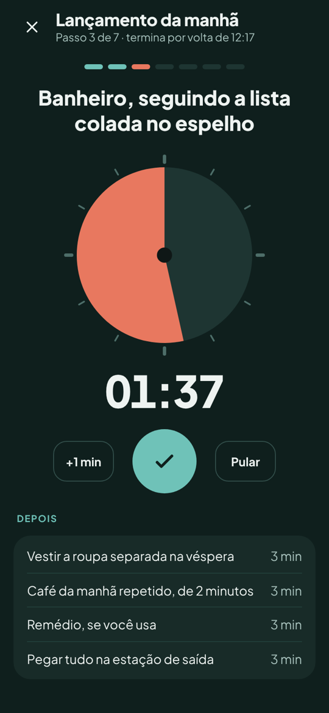<br><sub><b>Rotina guiada</b>, um passo por vez</sub></td>
    <td align="center">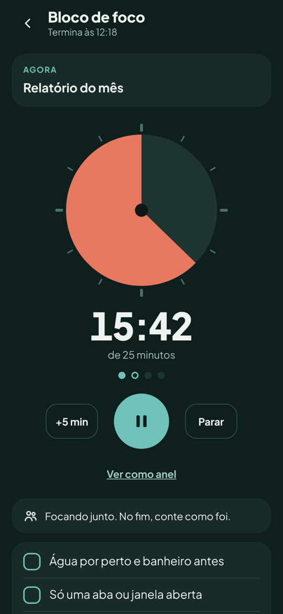<br><sub><b>Tempo visual</b> e ciclo de 4 blocos</sub></td>
    <td align="center">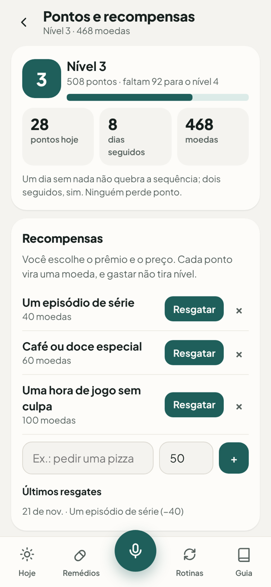<br><sub><b>Pontos e recompensas</b></sub></td>
  </tr>
</table>

## O que ele faz

| Área | O que tem |
| --- | --- |
| **Hoje** | Uma tela só com o que importa agora: o card **Agora** (o remédio da vez ou a prioridade, com o botão certo), ações rápidas (anotar, descarregar, foco de 25 min, dia ruim), o humor numa linha e o **Meu dia**, por Manhã, Tarde e Noite, com as 3 prioridades marcadas com ★. O resto do dia fica em linhas que abrem quando você toca. |
| **Captura mágica** | Escreva ou fale do seu jeito: "dentista sexta 15h no centro", "pagar a luz todo dia 10". O app separa a data, a hora, o local, a repetição e a categoria, e avisa no horário. Funciona sem IA; com IA, ainda fatia em passos. |
| **Humor em 1 toque** | Check-in na tela Hoje (animado, calmo, cansado, ansioso, pra baixo), com a frase do dia de recompensa, a energia e o humor da semana. |
| **Remédios e água** | Aviso na hora com **Tomei** e **Lembrar em 15 min**, novo aviso se você não marcar e aviso para **levar o remédio** quando a agenda tem compromisso no horário. |
| **Tocar no silencioso** | Remédios, tarefas, lembretes, rotinas e o fim do foco podem tocar pelo volume de alarme, mesmo com o celular no silencioso ou no vibrar. Tem botão de teste e aviso quando o volume de alarme está zerado. |
| **Horário de dormir** | Da higiene do sono até acordar, nada toca nem vibra: os avisos aparecem quietos. O lembrete que abre a higiene do sono continua tocando. |
| **Meta de água** | Meta em mL pelo peso (35 mL por kg), somando os lembretes marcados e os botões de copo. Bateu, ganha pontos. |
| **Próximo fixo** | Uma notificação fixa, sem som, com o próximo remédio e o passo atual, que só sai quando você conclui. |
| **Prioridades** | Matriz de Eisenhower: Faz hoje, Agenda, Rápido ou repassa e Solta. Prazo até amanhã sobe para urgente; o que fica 7 dias na Solta vai para "Talvez um dia". Sugere as 3 do dia: uma do Faz hoje, uma da Agenda e uma rápida. |
| **Tarefa em 3 fases** | **O quê** (pronto quando), **Como** (passos com minutos, material, quando) e **Faz** (os passos ficam travados e o foco mostra só o atual). |
| **Repetição e categorias** | Todo dia, dias úteis, dias da semana ou todo mês. Ao concluir (ou pular), a próxima volta sozinha. Categorias com cor (Casa, Trabalho, Saúde…) viram filtro na matriz. |
| **Bloco de foco** | Timer escuro com sino no fim, mesmo com a tela apagada, em anel ou em **disco de tempo visual**. Ciclo de pomodoro: pausa de 5 min e, a cada 4 blocos, pausa longa de 15. Liga o **Não perturbe** do Android durante o bloco e desliga sozinho no fim. **Foco acompanhado**: chame alguém pelo WhatsApp para focar junto, com aviso na metade. Conta os blocos de cada tarefa. A tela fica acesa e a barra de notificações mostra a contagem regressiva. Dá para estacionar uma ideia sem sair do foco. |
| **Rotinas** | 7 rotinas prontas (manhã, trabalho, foco, fim do expediente, noite, semana e SOS), com lembrete, versão mínima e dica para quando travar. **Rotina guiada**: um passo por vez, com os minutos de cada passo, disco de tempo, voz, pausa, passo extra só nesta vez e a opção de avançar sozinho. |
| **Calendário da semana** | Os próximos 7 dias com compromissos da agenda, tarefas com prazo e lembretes juntos, as atrasadas em destaque, criar tarefa num dia e mudar uma tarefa de dia. |
| **Pontos e recompensas** | Cada coisa feita vale pontos (tarefa, passo, remédio, foco, rotina, humor). Os pontos sobem de nível e viram moedas para recompensas que você mesmo cria. Tarefa parada vale mais, dia perfeito vale +20, sequência de dias que não quebra por um dia vazio, comemoração ao concluir e nada de perder pontos. |
| **Buscar** | A lupa no topo procura em tudo: tarefas e passos, lembretes, ideias, remédios, os dias anteriores (descarrego, feito, prioridades), rotinas e o guia. Sem ligar para acento. |
| **Guia** | 100 estratégias em 10 temas. Monte o seu kit, marque o status e anote o que funcionou. |
| **Assistente de IA** | Opcional. Fala ou texto, com Gemini (Google, com plano grátis) ou Claude (Anthropic). Se você pular na configuração, o passo a passo da chave fica em Ajustes e num aviso no Hoje. Responde no tom que você escolher: direto, encorajador ou bem-humorado. Vê a agenda, o dia e o humor, cria e fatia tarefas, marca passos, organiza o descarrego, cria lembretes e horários, marca compromissos da casa, fecha o dia e faz o resumo da semana. |
| **Agenda da casa** | Um calendário do Google compartilhado: o que uma pessoa marca aparece no celular da outra. |
| **Compartilhar tarefa** | Manda uma tarefa pelo WhatsApp como link. Quem tem o app toca e a tarefa abre direto nele, com passos e prazo, pronta para entrar na matriz. |
| **Aviso de versão nova** | Uma vez por dia o app confere se saiu versão nova. Se saiu, mostra as novidades na tela Hoje com o botão **Baixar e instalar**. |
| **Resumo da semana** | Domingo às 19h: tarefas concluídas, as 3 do dia, remédios marcados, humor e o dia que mais rendeu. |
| **Mais** | Revisão da semana, ideias, hábitos sem data, lembretes, tema claro, escuro ou automático e configuração guiada na primeira abertura. |

## Instalar no celular

1. Abra a página de [Releases](../../releases/latest) no celular e baixe `tdah-vida-real.apk`.
2. Toque no arquivo. Se o Android pedir, permita "instalar apps desconhecidos" para o navegador ou o app de arquivos.
3. Se o Play Protect avisar que o app é desconhecido, toque em **Mais detalhes › Instalar mesmo assim**. O aviso aparece porque o app não está na Play Store.
4. Abra o app e responda a configuração guiada (uns 5 minutos).

O app avisa quando sai versão nova (a partir da 1.8). Versões novas instalam **por cima** da anterior, sem perder dados. Não desinstale antes de atualizar: desinstalar apaga o que não estiver no backup.

Requer Android 7 ou mais novo. Não há versão para iPhone.

## Primeiro uso

1. **Configuração guiada:** horários, o que mais trava, remédios e água, um texto sobre você para o assistente e as permissões.
2. **Permissões:** Notificações e "Alarmes e lembretes" para os avisos chegarem na hora; Agenda para ler os compromissos; Microfone só para o ditado.
3. **Silencioso:** menu ☰ › Ajustes › **Tocar no silencioso**. Ligue o que deve tocar mesmo com o celular no silencioso e toque em **Testar remédio**.
4. **Não perturbe no foco (opcional):** Ajustes › Bloco de foco › **Não perturbe durante o foco**. O Android abre a lista de acesso ao Não perturbe; ative o TDAH na Vida Real e volte.
5. **Backup:** menu ☰ › Ajustes › **Conectar Google Drive**. O app grava sozinho a cada 6 horas de uso.
6. **IA (opcional):** Ajustes › **Assistente de IA**, ou o microfone do meio da barra de baixo. O passo a passo da chave aparece lá; a do Gemini é grátis.

Para a agenda do trabalho aparecer, ela precisa estar sincronizada no calendário do Android (no app do Outlook: Configurações › sua conta › Sincronizar calendários).

## Assistente de IA

Cada pessoa usa a própria chave de API, que fica só no celular e nunca vai no backup.

| | Gemini (Google) | Claude (Anthropic) |
| --- | --- | --- |
| Custo | Plano gratuito com limite de uso; só cobra se você ativar o faturamento | Pago por uso, com créditos na conta |
| Assinatura cobre a API? | Não | Não |
| Onde pegar a chave | [aistudio.google.com/app/apikey](https://aistudio.google.com/app/apikey) | [console.anthropic.com/settings/keys](https://console.anthropic.com/settings/keys) |
| Privacidade | No plano gratuito, o Google pode usar o conteúdo enviado para melhorar os produtos, inclusive com revisão humana ([termos](https://ai.google.dev/gemini-api/terms)) | Vale a política de dados da Anthropic para a API |

Por padrão, o assistente não recebe os nomes dos remédios nem os itens do "Corpo em dia"; isso só muda se você ligar a opção em Ajustes. A chamada vai direto do celular para a API escolhida, sem servidor no meio.

## Privacidade e dados

- **Tudo fica no aparelho**, num banco IndexedDB dentro do app. Não existe cadastro.
- **Backup no seu Google Drive:** o app grava num arquivo que você escolhe, pelo seletor de arquivos do Android. Nenhum servidor nosso, nenhum login extra.
- **O que sai do celular:** o backup no seu Drive, o que você manda ao assistente de IA e os compromissos da Agenda da casa, que ficam no seu Google Agenda.
- **Tarefa compartilhada:** o conteúdo vai dentro do link, depois do `#`, parte que o navegador não envia a nenhum servidor. O site `cidedson.github.io` só faz a ponte para abrir o app.
- **Aviso de versão nova:** uma vez por dia o app pergunta ao GitHub qual é a última versão. Nenhum dado seu vai junto, e dá para desligar em Ajustes › Sobre o app.
- **O que nunca sai:** a chave de API.
- Também dá para exportar e importar um backup em JSON por Ajustes.

## Como funciona por dentro

- **Interface:** JavaScript puro em `src/`, empacotado com esbuild em `www/app.js`. Estilos e tema em `www/index.html`.
- **App Android:** [Capacitor](https://capacitorjs.com) 8, com os plugins de notificações locais, agenda, reconhecimento de voz, arquivos e compartilhamento.
- **Código nativo próprio** em `android/app/src/main/java/com/cidedson/tdahvidareal/`:
  - `DocBackupPlugin.java`: backup e restauração num arquivo do Google Drive pelo seletor de documentos do Android.
  - `AlertaPlugin.java`: canais de notificação (os terminados em `_alarme` usam o volume de alarme e tocam no silencioso), volume de alarme e o Não perturbe do foco.
  - `NaoPerturbeReceiver.java`: desliga o Não perturbe no fim do bloco, mesmo com o app fechado.
- **Arquivos principais:**

| Arquivo | O que tem |
| --- | --- |
| `src/app.js` | Telas, navegação, foco, prioridades, repetição, resumo da semana, notificação fixa |
| `src/capture.js` | Captura mágica: lê data, hora, local e repetição de um texto em português |
| `src/assistant.js` | Assistente (Claude e Gemini), ferramentas e o fatiador de tarefas |
| `src/mood.js` | Humor em 1 toque e as frases do dia |
| `src/native.js` | Agenda, notificações, voz, backup no Drive, compartilhar |
| `src/sharelink.js` | Link de tarefa compartilhada (conteúdo comprimido dentro do link) |
| `src/update.js` | Aviso de versão nova (consulta a última versão no GitHub) |
| `src/events.js` | Ajuste dos eventos de dia inteiro da agenda |
| `src/db.js` | Banco IndexedDB, exportar e importar |
| `src/content.js` | As 100 estratégias e as 7 rotinas |

## Gerar o APK

O APK é gerado pelo GitHub Actions (`.github/workflows/android.yml`) a cada push na branch `main` e publicado em Releases. Não precisa de Android Studio.

- A versão vem de `APP_VERSION` no workflow mais o número do build (ex.: `1.7.21`).
- Para a atualização instalar por cima, todo APK precisa ser assinado com a **mesma chave**. A chave não fica no repositório: o workflow lê dos secrets (Settings › Secrets and variables › Actions) e para com erro se eles faltarem.

| Secret | Conteúdo |
| --- | --- |
| `KEYSTORE_BASE64` | O arquivo `.keystore` em base64 (`base64 -w0 minha.keystore`) |
| `KEYSTORE_PASSWORD` | Senha do keystore |
| `KEY_ALIAS` | Alias da chave (se faltar, usa `tdah`) |
| `KEY_PASSWORD` | Senha da chave (se for igual à do keystore, pode omitir) |

Num fork, crie a sua própria chave com `keytool -genkeypair -v -keystore minha.keystore -alias minha -keyalg RSA -keysize 2048 -validity 10000`, cadastre os secrets e guarde o arquivo num lugar seguro: sem ele, não dá para atualizar o app por cima.

## Desenvolvimento

```bash
npm install
npm run build                                   # gera www/app.js
python3 -m http.server --directory www 8000     # testar no navegador (sem os recursos nativos)
npx cap sync android                            # copia para o projeto Android
```

No navegador, agenda, notificações e backup no Drive ficam desligados; o resto funciona, inclusive o assistente com uma chave.

## Versões

O que mudou em cada versão está em [CHANGELOG.md](CHANGELOG.md).

## Contribuir

- Achou um erro ou tem uma ideia? Abra uma [issue](../../issues/new/choose): tem modelo para erro e para ideia.
- Vai mexer no código? Veja [CONTRIBUTING.md](CONTRIBUTING.md).
- Falha de segurança ou de privacidade: siga [SECURITY.md](SECURITY.md), sem abrir issue pública.

## Créditos

- Fonte [Plus Jakarta Sans](https://github.com/tokotype/PlusJakartaSans), licença SIL Open Font License 1.1 (`www/fonts/OFL.txt`).
- Feito com [Capacitor](https://capacitorjs.com) e [esbuild](https://esbuild.github.io).
